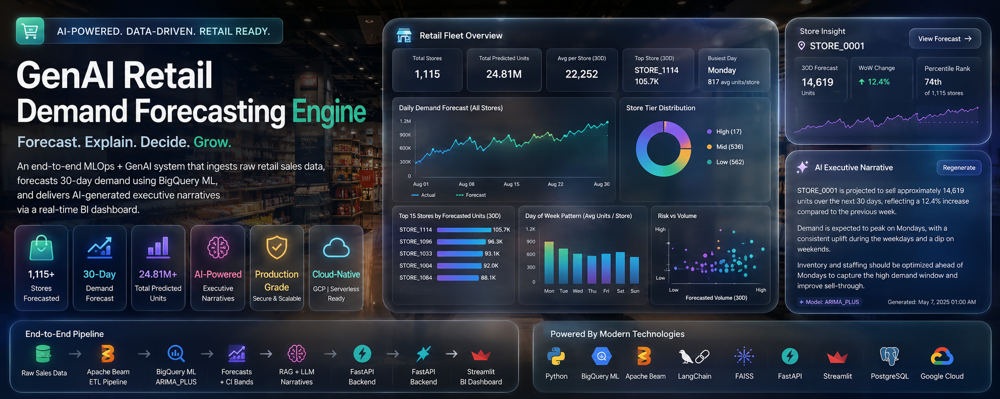
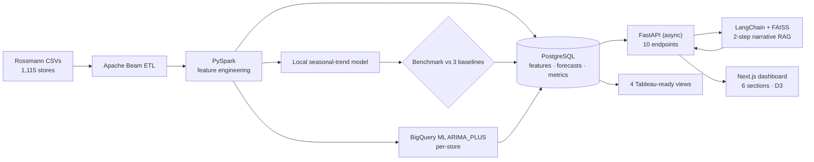
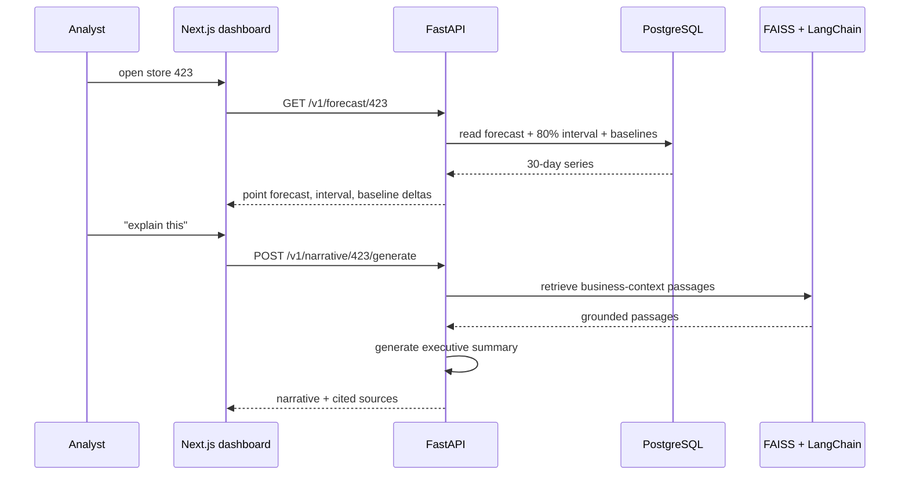

# RetailForecastAI

> End-to-end retail demand forecasting — real ML on a real dataset, benchmarked against honest baselines, a RAG layer that explains the forecasts in plain language, and a full-stack product surface on top of it.


---

## Highlights

- Achieved **16.92% MAPE** with a local seasonal-trend model on a **30-day Rossmann holdout** across **1,115 stores**, beating seasonal-naive and 7- and 28-day moving-average baselines at **21.91–24.74% MAPE** — closed-store days excluded from percentage-error scoring.
- Built a separate **BigQuery ML `ARIMA_PLUS`** workflow generating **33,450 daily forecasts** across **1,115 stores** over a 30-day horizon, with nominal **80% prediction intervals** so planners read a range rather than a single number.
- Owned a **5-layer ML product path** — Apache Beam ETL, PySpark features, PostgreSQL storage, async FastAPI, Next.js dashboard — turning raw Rossmann CSVs into a usable forecasting product instead of a notebook.
- Built a **2-step LangChain + FAISS RAG flow** that retrieves business-context passages before generating executive summaries, exposing the grounding sources through the live `/v1/narrative/{id}/generate` endpoint.
- Shipped **10 backend endpoints** covering forecasts, narratives, fleet summaries, daily trends, day-of-week patterns, narrative coverage, baseline metrics and authenticated pipeline runs from one auditable PostgreSQL-backed API.
- Structured **4 Tableau-ready reporting views** — forecast outputs, baseline metrics, fleet summaries, store-level trends — so analysts can work in the tool they already use.
- Created a **6-section Next.js dashboard** with D3 charts, computed insight captions, store comparisons and model benchmarks, where every number comes from the API rather than hardcoded UI data.
- Preserved **2 execution paths**: a no-billing local path (Docker, PostgreSQL, FAISS) and a full cloud path (GCS, Dataflow, BigQuery ML, Cloud Run) from the same codebase, so cost never gates evaluation.

---

## Architecture



## Forecast and narrative flow



---

## Backtested accuracy

30-day holdout, 1,115 stores, 33,450 rows. MAPE ignores zero-actual closed-store days.

| Model | MAPE | MAE |
|---|---|---|
| **`local_seasonal_trend`** | **16.92** | **1,898.84** |
| `seasonal_naive_7d` | 21.91 | — |
| `moving_average_28d` | 23.03 | — |
| `moving_average_7d` | 24.74 | — |

`ARIMA_PLUS` is the separate per-store cloud path and is reported with 80% prediction intervals rather than a single headline accuracy number.

## Tech stack

**Data** Apache Beam · PySpark · Pandas · PostgreSQL · SQLAlchemy · Alembic
**ML** BigQuery ML `ARIMA_PLUS` · seasonal-trend forecasting · baseline benchmarking
**AI** LangChain · FAISS · vector search · LLM narratives
**API** FastAPI · Pydantic
**Frontend** Next.js · React · TypeScript · Tailwind · shadcn/ui · D3.js · Three.js
**Platform** Docker Compose · GitHub Actions · Google Cloud Run · Workload Identity Federation

## Two ways to run it

```bash
# Local path — no cloud billing
docker compose up -d        # PostgreSQL + FAISS + FastAPI
make etl && make train && make backtest
```

```bash
# Cloud path — GCS + Dataflow + BigQuery ML + Cloud Run
make deploy-cloud
```

```bash
cd frontend && npm install && npm run dev    # http://localhost:3000
```

---

**Built by [Brijesh Kumar](https://github.com/Brijesh03032001)** · [Portfolio](https://brijeshbuilds.com) · [LinkedIn](https://linkedin.com/in/brijeshkumar03)
